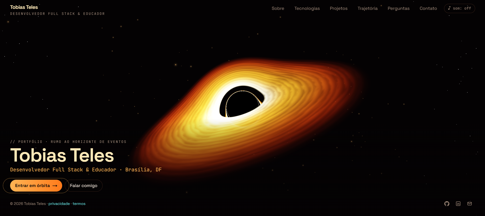
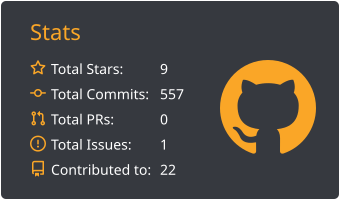
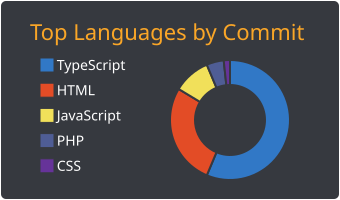
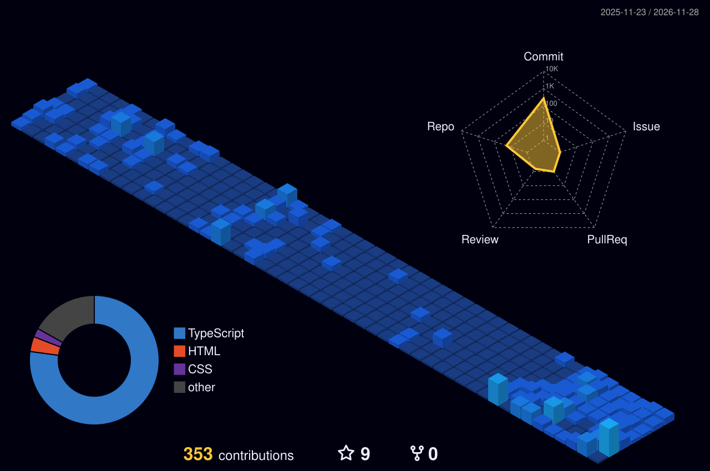

<p align="center">
  
</p>

<h1 align="center">Olá, eu sou o Tobias Teles 👋</h1>

<p align="center">
  <a href="https://github.com/tobiasteles">
    
  </a>
</p>

<p align="center">
  <code>// PORTFÓLIO · RUMO AO HORIZONTE DE EVENTOS</code>
</p>

<p align="center">
  Estudante de Análise e Desenvolvimento de Sistemas · Formação em Física (UnB) · Brasília, DF
</p>

<p align="center">
  
</p>

<p align="center">
  <a href="https://tobiasteles.dev"></a>
  <a href="https://www.linkedin.com/in/tobias-teles/"></a>
  <a href="mailto:tobias.teles@gmail.com"></a>
</p>

<p align="center">
  <b>💻 Meu portfólio é um terminal.</b> <a href="https://tobiasteles.dev">Acesse</a> e digite <code>projects</code> ou <code>resume</code>.
</p>

---

### 👨‍💻 Em resumo

```ts
const tobias = {
  funcao: "Desenvolvedor Full-Stack",
  stack: ["Next.js", "React", "TypeScript", "Node.js", "PostgreSQL"],
  gosto: ["serverless", "autenticação", "dashboards", "integração com IA"],
  formacao: ["Física (UnB)", "Análise e Desenvolvimento de Sistemas (UNINTER, cursando)"],
  local: "Brasília, DF",
  status: "aberto a novas oportunidades",
  contato: "tobias.teles@gmail.com",
};
```

---

### 🚀 Sobre mim

Desenvolvo aplicações web completas, do banco de dados à interface, com foco em **JavaScript/TypeScript** e arquiteturas **serverless**. Desde 2024 construo e publico projetos reais, incluindo sistemas de avaliação, gamificação e e-commerce para a ONG **Edukhan**.

Minha formação em Física (UnB) me deu base analítica para resolver problemas com método. Estou aberto a novas oportunidades em desenvolvimento de software, principalmente em equipes onde eu possa aprender e contribuir com entregas de qualidade.

- 🔭 **Trabalhando agora em:** ecossistema educacional gamificado com Next.js, TypeScript, Drizzle ORM e Neon DB
- 🎓 **Estudando:** Análise e Desenvolvimento de Sistemas (UNINTER)
- 🧪 **Explorando:** automação com Playwright, Canvas/WebGL e integração com IA (Google GenAI SDK)

---

### 🎯 O que eu entrego

- **Aplicações completas, do zero ao deploy:** banco, back-end, interface e publicação na Vercel
- **Autenticação e segurança:** Clerk, sessões JWT com JOSE e validação rigorosa com Zod
- **Painéis administrativos e dados:** React Admin, gráficos interativos com Recharts e leitura de PDFs
- **Pagamentos e integrações:** Stripe, Firebase e Google GenAI SDK
- **Software em uso real:** sistemas que atendem a ONG Edukhan, não só projetos de estudo

---

### 🛠 Tech Stack

#### Front-end
[](https://nextjs.org/)
[](https://react.dev/)
[](https://www.typescriptlang.org/)
[](https://developer.mozilla.org/pt-BR/docs/Web/JavaScript)
[](https://tailwindcss.com/)
[](https://tanstack.com/query)

#### Back-end e banco de dados
[](https://nodejs.org/)
[](https://www.postgresql.org/)
[](https://neon.tech/)
[](https://orm.drizzle.team/)
[](https://www.prisma.io/)
[](https://firebase.google.com/)

#### Ferramentas e integrações
[](https://git-scm.com/)
[](https://stripe.com/)
[](https://zod.dev/)
[](https://clerk.com/)
[](https://playwright.dev/)
[](https://vercel.com/)

---

### 🏗️ Projetos em destaque

<table>
  <tr>
    <td width="300" align="center">
      <a href="https://prova.edukhan.ong.br/">
        
      </a>
    </td>
    <td>
      <h4>📝 Edukhan Avaliações</h4>
      Sistema web para gestão e aplicação de avaliações educacionais da ONG Edukhan, com autenticação via Clerk, painel administrativo com React Admin e formulários com validação rigorosa.<br/><br/>
      <b>Stack:</b> Next.js · React · TypeScript · Tailwind · Clerk · Drizzle ORM · Neon DB · React Admin · Zod · React Hook Form<br/><br/>
      <a href="https://prova.edukhan.ong.br/">🔗 Ver online</a> · <a href="https://github.com/tobiasteles/edukhan-avaliacoes.git">💻 Código</a>
    </td>
  </tr>
  <tr>
    <td width="300" align="center">
      <a href="https://miravita-three.vercel.app/">
        
      </a>
    </td>
    <td>
      <h4>🎮 Miravita</h4>
      MMORPG jogável no navegador que integra elementos pedagógicos a um universo de fantasia, com classes inspiradas em disciplinas escolares, itens e hierarquias baseados na tabela periódica e inteligência artificial integrada.<br/><br/>
      <b>Stack:</b> Next.js · React · TypeScript · Tailwind · Clerk · Drizzle ORM · Neon DB · Google GenAI SDK<br/><br/>
      <a href="https://miravita-three.vercel.app/">🔗 Ver online</a> · <a href="https://github.com/tobiasteles/miravita.git">💻 Código</a>
    </td>
  </tr>
  <tr>
    <td width="300" align="center">
      <a href="https://ecobazar-drab.vercel.app/">
        
      </a>
    </td>
    <td>
      <h4>🌱 EcoBazar</h4>
      Plataforma de e-commerce e comércio sustentável, com gestão de catálogo de produtos, visualização analítica de dados com gráficos interativos e banco de dados serverless.<br/><br/>
      <b>Stack:</b> Next.js · React · TypeScript · Tailwind · Drizzle ORM · Neon DB · TanStack Query · Recharts · Shadcn UI<br/><br/>
      <a href="https://ecobazar-drab.vercel.app/">🔗 Ver online</a> · <a href="https://github.com/tobiasteles/ecobazar">💻 Código</a>
    </td>
  </tr>
  <tr>
    <td width="300" align="center">
      <a href="https://financeiro-neon-phi.vercel.app/">
        
      </a>
    </td>
    <td>
      <h4>💰 Orçamento Familiar Neon</h4>
      Aplicação web para controle de finanças e orçamento familiar, com banco de dados serverless, autenticação e sessões seguras com JOSE e leitor de extratos e comprovantes bancários em PDF.<br/><br/>
      <b>Stack:</b> Next.js · React · TypeScript · Tailwind · Neon DB · JOSE · PDF Parse<br/><br/>
      <a href="https://financeiro-neon-phi.vercel.app/">🔗 Ver online</a> · <a href="https://github.com/tobiasteles/financeiro-neon.git">💻 Código</a>
    </td>
  </tr>
</table>

#### Mais projetos
- 🎯 [Banco de Pontos Edukhan](https://bancodepontosedukhan.netlify.app/): gamificação em que professores registram pontuações e trocas de pontos por prêmios, por unidade (Next.js, Drizzle ORM, Neon DB)
- 🛍️ [Edukhan E-commerce](https://github.com/tobiasteles/ecommerce-store-edukhan): loja para arrecadar fundos para a ONG, com painel administrativo completo (Next.js, Prisma, PostgreSQL, NextAuth)
- 💻 [Portfólio interativo em terminal](https://tobiasteles.dev): portfólio em linha de comando com painel admin e autenticação JWT (Next.js, Drizzle ORM, Neon DB)
- 📚 [Reforço+](https://reforcomais.netlify.app/): site de aulas de reforço com formulário de agendamento (HTML, CSS, JavaScript)
- 📺 **MentorPlay:** plataforma de compartilhamento de vídeos (Next.js, Firebase)

---

### 📊 GitHub Stats

<div align="center">





<br/><br/>



<br/><br/>

<!-- Cobrinha das contribuições: precisa do workflow .github/workflows/snake.yml -->
<picture>
  <source media="(prefers-color-scheme: dark)" srcset="https://raw.githubusercontent.com/tobiasteles/tobiasteles/output/github-contribution-grid-snake-dark.svg?v=2" />
  <source media="(prefers-color-scheme: light)" srcset="https://raw.githubusercontent.com/tobiasteles/tobiasteles/output/github-contribution-grid-snake.svg?v=2" />
  
</picture>

</div>

---

### 💡 Filosofia

> "Assim como na física, aplicações robustas dependem de **fundamentos sólidos** (TypeScript), **estruturas eficientes** (Next.js/Drizzle) e a busca constante pela **entropia mínima** no código."

---

### 🤝 Vamos conversar?

Se você está montando um time e procura alguém que entregue, aprenda rápido e já tenha software no ar, vou adorar trocar uma ideia.

<p align="center">
  <a href="mailto:tobias.teles@gmail.com"></a>
  <a href="https://www.linkedin.com/in/tobias-teles/"></a>
  <a href="https://tobiasteles.dev"></a>
</p>
